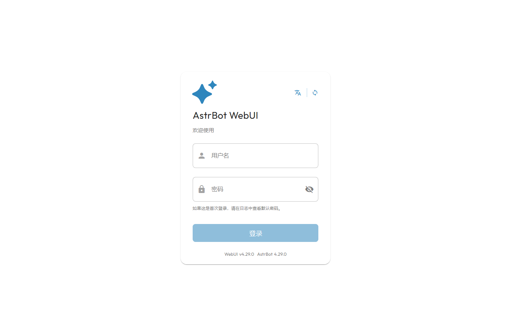

# QQ 毒舌群友

AI 奇妙实验室第二期：复用 AstrBot 和 QQ 官方机器人，把四种群友人格、主动接梗、图片理解和可删除记忆带到获授权的 QQ 群。

**当前状态：离线候选包，尚未完成真实 QQ 验收。** 已实现的功能不等于已通过真实平台实测；正式 `v1.0.0` 需要用户本地授权和集中验收后发布。没有真实 QQ 聊天截图，也不把模拟输出当成真人体验。

Windows 用户从本仓库 Releases 下载 `QQ-AI-Bot-v1.0.0-Windows-x64.zip`（正式发布前仅提供草稿附件），完整解压后双击 `启动机器人.bat`。自带官方 Python，无需安装 Python、Git、Docker 或 pip。**首次启动必须联网**下载 149 个带哈希锁定的 Python 依赖；QQ 和 DeepSeek 在使用中也需要联网。不能离线首次安装。

ZIP 顶层直接提供启动、打开面板、停止、重置密码和首次使用入口。首次设置与密码重置共用本地 Windows 窗口：两个密码框分别有小眼睛，默认隐藏、可主动查看。忘记密码只需先停止再重置；不会清空配置或重装框架。旧安装可覆盖 `QQ-AI-Bot-Windows-体验修复补丁.zip`，保留 data 和全部依赖。

- [新手安装指南](docs/新手安装指南.md)
- [QQ 官方机器人配置与权限边界](docs/QQ官方机器人配置.md)
- [常见故障](docs/常见故障.md)
- [开发、依赖与许可证](docs/开发和许可证说明.md)
- [验收报告与未验证项目](docs/验收报告.md)

支持 Windows 10/11 x64；建议可用磁盘至少 3 GB，避免放在只读目录和压缩包内运行。安装目录和所有配置均留在解压目录；不修改系统 Python、不添加开机任务。

下面是本次 Windows 整合包实际启动后的原生面板登录页，无 QQ 账号、密钥或群消息。页面的默认“日志中查看密码”提示来自上游；本包使用你首次启动时自行设置的密码。

默认安静、禁止主动插话、关闭上下文收集和长期记忆。先配置管理员、允许群，并在群里告知成员，然后分别开启需要的能力。群成员可以 `/退出记忆`、`/别吐槽我`；管理员可以即时 `/闭嘴`。

预设人格：毒舌损友、抽象串子、深夜 EMO、理性吐槽役。趣味指令包括 `/串子`、`/emo`、`/吐槽`、`/推荐歌`、`/推荐书`。推荐来自小型真实作品目录，使用本地关键词匹配，不产生额外模型调用。发送 `/帮助` 查看全部命令。

框架锁定 AstrBot `v4.29.0`；默认模型建议 `deepseek-flash`，模型 ID 可在 AstrBot 原生 WebUI 修改。只使用 QQ 官方 WebSocket，不捆绑非官方 QQ 客户端。机器人能否入群、收到普通消息及主动发言取决于 QQ 官方账号与群设置，不能保证任意群可用。

自有代码与人格文件按 AGPL-3.0-or-later 发布；完整许可证见 [LICENSE](LICENSE)，第三方许可和来源见 [NOTICE-THIRD-PARTY.md](NOTICE-THIRD-PARTY.md)。通过 QQ `/帮助` 及本仓库可获取对应源代码。项目只计划集中完成一次 v1.0.0，不承诺持续维护。
