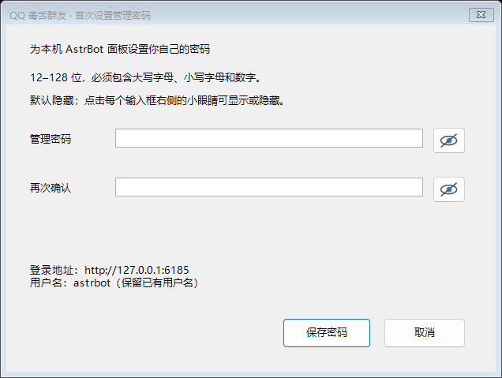

# Windows 新手安装指南

v1.0.0 发布准备。基础 QQ 群身份、授权和 AI 文字回复已获用户真人确认；未验证的高级功能见 [验收报告](验收报告.md)。首次设置、重置和更新不会要求删除配置或重装框架。

## 第一步：下载、解压、设置面板密码

从 [Releases](https://github.com/chen-yy2008/qq-ai-bot-starter/releases) 下载 `QQ-AI-Bot-v1.0.0-Windows-x64.zip`，正式发布前使用公开候选版，不要下载 Source code 来代替。可在 PowerShell 用 `Get-FileHash -Algorithm SHA256 -LiteralPath '你的ZIP完整路径'` 对照 `SHA256SUMS.txt`。支持 Windows 10/11 x64，至少预留 3 GB。

右键“全部解压”到有写入权限的目录，不在压缩包里运行。ZIP 平铺，第一层直接是启动、打开面板、停止、重置、更新、诊断和首次使用入口；无需进“程序文件”。双击 **启动机器人.bat**。

首次先出现本机 Windows 密码窗口。输入两遍，两个小眼睛分别显示/隐藏，默认隐藏。要求 12–128 位，包含大小写字母和数字，错误在窗口内提示。密码只在本机处理，不在命令行、日志、明文配置中保存。取消或失败不会覆盖原配置。



随后联网安装锁定依赖，需要几分钟；无需系统 Python/Git/Docker。完成后浏览器自动打开，默认地址 `http://127.0.0.1:6185`、用户名 `astrbot`，使用刚设置的密码。已有用户名/端口保留，以成功窗口提示为准。请保存好密码；浏览器未弹出可双击 **打开管理面板.bat**。

## 第二步：接入 QQ，获取身份

1. 在面板“平台”添加 QQ 官方机器人 WebSocket，填写自己机器人的 AppID、AppSecret，只保存在本机。按 QQ 平台要求完成账号、测试范围和权限设置，见 [QQ 配置指南](QQ官方机器人配置.md)。
2. 把机器人加入自己有权限的群。群设置允许“获取全部群消息”和“主动发言”；这些权限不会由插件自动授予。只有 @ 消息权限时无法获得普通讨论上下文。
3. 确认插件开启，群内先检查 `/help`、`/sid`，再发送 `/身份`。无需先选模型或允许群，不产生模型请求。命令冲突可用 `/毒舌身份`。
4. 复制**自己的发送者 ID**到 AstrBot“配置文件 → 访问控制 → 管理员列表”；复制**本群 ID**到插件 `allowed_groups`。保存并重载插件。QQ 群主与 AstrBot 管理员是两套权限，官方 OpenID 也不一定等于 QQ 号或显示群号，不要自行替换成日常号码。

## 第三步：选择正确的 DeepSeek 模型实例

在模型页面创建并启用官方 DeepSeek OpenAI 兼容模型，Base URL `https://api.deepseek.com/v1`，Key 只在模型页面填写。模型名称以账号实际可用列表为准。本次用户真实成功配置是：

| 页面字段 | 本次实例 |
|---|---|
| 提供商源 ID | `deepseek` |
| 模型名称 | `deepseek-flash` |
| 模型提供者实例 ID（插件需要） | **`deepseek/deepseek-flash`** |

回到插件设置，在 `provider_id` 模型选择器中选择上述**模型实例**，保存并重载。若界面只能输入文本，完整填写 `deepseek/deepseek-flash`，不要只填 `deepseek`。找不到模型先确认它已创建并启用；选择列表可能还包含其他供应商，只选官方 DeepSeek。此类本地 ID 错误不需要重填 Key。

## 第四步：群内授权和基础对话

先向成员说明机器人的用途和消息可能发往 DeepSeek；完成告知后，由刚配置的 AstrBot 管理员发送：

```text
/启用群聊 已告知群友
```

收到“本群已授权”后用 `/帮助`、`/状态` 检查设置，再发送 `/吐槽 为什么大学早八这么折磨人`，或 @ 机器人说一句话。前两者不调用模型，后两者消耗自己的 API 额度；明确请求默认冷却 20 秒，测试时逐条等待。模型源 ID 和实例 ID 不匹配会有具体提示，服务端 5xx 会说明稍后再试。

## 第五步：人格、上下文和实验主动接话

`/人格` 查看四套风格；管理员例如发送 `/人格 理性吐槽役`。提示词不能保证回答聪明或正确。想调整人格可编辑本机 `data/plugins/astrbot_plugin_qq_ai_lab/personas/*.json`，保存后重载；更新不会覆盖这些文件。

需要上下文时，先告知成员并获得同意：最近最多 24 条、每条 400 字、10 分钟的消息可能发给模型，重启不会保留短期原文。然后**分两条**发送：

```text
/上下文 开启 已告知群友
/主动 自然
```

想增加候选机会可把第二条改为 `/主动 活跃`。不要写 `/主动 活跃 已告知群友`。

| 档位 | 直观行为 |
|---|---|
| 安静（默认） | 不主动插话，仍可响应命令与 @ |
| 自然 | 较少接话，候选概率 15%，最短间隔 120 秒 |
| 活跃 | 较多候选，概率 40%，最短间隔 60 秒，仍可能沉默 |

未 @ 时不会每条必回：需群已授权、上下文已开启、QQ 允许主动发言，最近 45 秒至少 3 条消息且至少两位成员参与；长篇消息、静音、北京时间 00:00–08:00 休息、冷却、每日候选/请求/Token/估算费用上限都会限制触发，模型也可选择沉默。默认每天最多 8 次主动候选，不等于 8 次必发。这一能力尚未完成两人自然讨论真人验收。

`/闭嘴` 即时静音主动模式，命令和 @ 仍可用；`/开麦` 恢复原档；`/主动 安静` 关闭主动档；`/上下文 关闭` 停止收集并清空短期上下文；`/停用群聊` 撤销授权。

图片理解和长期记忆仍为实验功能，未完成真人验收。图片需模型确实支持视觉，文字成功不代表能看图；`/图片 关闭` 禁止插件传图。长期记忆默认关闭，告知同意后 `/长期记忆 开启 已告知群友`，管理员手动 `/记住 自愿共享内容`，用 `/回忆 关键词`、`/忘记 关键词`、`/清空记忆` 查询/删除。不是自动记下全部聊天。成员可 `/退出记忆`、`/别吐槽我`。

## 停止、忘记密码、更新与排障

双击顶层 **停止机器人.bat**。忘记密码时先停止，再点 **重置管理密码.bat**；共用同一个带小眼睛的窗口，仅改认证哈希、认证状态和会话密钥。保留用户名、端口、二步验证、Key、QQ、插件和数据，旧令牌失效。运行中/配置损坏/写入失败会拒绝覆盖。不要删除 data。

更新双击 **检查并更新.bat**；旧包缺入口时从 Release 下载 **QQ-AI-Bot-Update-Start.bat**，选择原目录。查看清单并确认后自动完成校验、备份、停止、安装、重启。候选版向正式版的过渡在正式公开后启用。无需手工解压覆盖或重装。详见 [更新与诊断](更新与诊断.md)。

无回复用 **安全诊断.bat**：开启、重启、复现、查看、关闭，最多一小时失效。只分享阶段/错误类别，不分享原始消息、Key、Secret、身份或整个 data。费用是保守自定义单价估算，不是官方报价或实际账单，以 DeepSeek 控制台为准。
